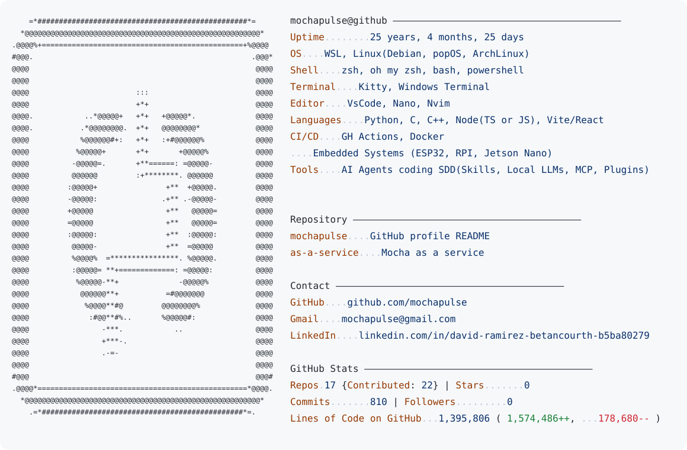

<a href="https://github.com/mochapulse/mochapulse">
  <picture>
    <source media="(prefers-color-scheme: dark)" srcset="https://raw.githubusercontent.com/mochapulse/mochapulse/main/dark_mode.svg">
    
  </picture>
</a>

<i>AI agents &middot; Embedded systems &middot; RF &amp; SDR &middot; Networking</i>

  
  
  
  

